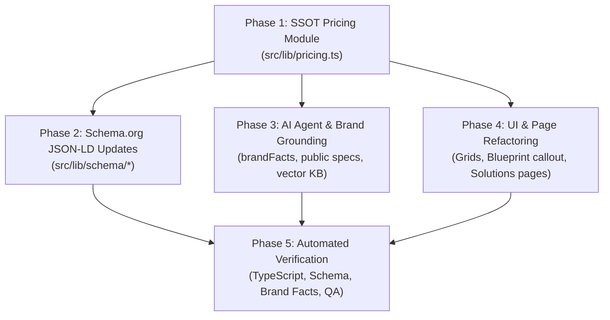

# AEObility Technical Sprint Pricing Implementation Plan

## Executive Overview
This implementation plan establishes a centralised, single source of truth (SSOT) for AEObility pricing and commercial terms. It refactors Schema.org structured data generators, updates AI Bill and agent grounding contexts, and synchronises all public-facing UI components and comparison pages.

---

## Phase Overview & Dependency Graph



---

## Phase 1: Single Source of Truth (SSOT) Pricing Architecture

**Target File**: `src/lib/pricing.ts` *(New File)*

### 1. TypeScript Interfaces
- `SprintSKU`: Code, title, subtitle, price in AUD (ex. GST), delivery SLA, category (`blueprint`, `onboarding`, `macro`, `micro`, `foundation`, `enterprise`, `hourly`), purpose, itemised deliverables array, and `isWaivedWithPackage` flag.
- `PricingTier`: Identifier, tier name, commercial tagline, formatted display price, numerical `priceExGst`, SLA, target client goal, itemised deliverables, associated SKU codes, recommendation badge (`popular`), CTA copy, and target destination URL.
- `GovernanceRules`: Standardised commercial parameters including 60-day credit window, $995 credit value, $220/hr developer rate, client IP ownership, and retainer terms.

### 2. Catalog Definition (`TECHNICAL_SPRINT_CATALOG`)
- **Diagnostic Core**:
  - `BPSTRAT`: Strategic Blueprint ($995 AUD ex. GST, 5 Business Days SLA).
- **Onboarding Setup**:
  - `ONBOARD`: Technical Onboarding & Setup ($250 AUD ex. GST, 2 Business Days SLA, waived with packages).
- **Foundation Offerings**:
  - `AEO-FOUNDATION`: Foundation Core Turnkey ($3,195 AUD ex. GST, 4 Weeks SLA, 10 Priority Pages).
  - `AEO-FOUNDATION-DIRECT`: Direct Modular Foundation ($1,990 AUD ex. GST, 2–3 Weeks SLA).
- **Macro Sprints (`SS1MACRO`–`SS4MACRO`)**: $1,980 AUD ex. GST each, 10 Business Days SLA:
  - `SS1MACRO`: Canonical Brand Identity & Entity Resolution Graph.
  - `SS2MACRO`: Commercial Intent & Answer Architecture Refactoring.
  - `SS3MACRO`: Semantic Lattice & Dense Passage Extraction.
  - `SS4MACRO`: External Authority Alignment & Multi-Platform Citation Sync.
- **Micro Sprints (`SS1MICRO1`–`SS4MICRO4`)**: $495 AUD ex. GST each, 3 Business Days SLA:
  - 16 modular task units distributed across the 4 foundational pillars.
- **Enterprise & Ad-hoc**:
  - `ADV-LATTICE`: Advanced Semantic Lattice ($6,359 AUD ex. GST, 15–20 Business Days SLA).
  - `HO-ROADMAP`: Handover Roadmap ($155 AUD ex. GST, 3–5 Business Days SLA).
  - `HOURLY-DEV`: Hourly Technical Engineering ($220 AUD + GST / hour).

### 3. Helper Utilities
- `formatAudCurrency(amount: number)`: Outputs formatted Australian Dollar strings (e.g., `$1,980 AUD ex. GST`).
- `calculateNetBalance(basePrice: number, appliesBlueprintCredit: boolean)`: Deducts the $995 audit fee when the credit window is valid.

---

## Phase 2: Schema.org Structured Data Refactoring

**Target Files**:
- `src/lib/schema/aeoSprint.ts`
- `src/lib/schema/solutions.ts`
- `src/lib/schema/aeoBlueprint.ts`

### Implementation Steps
1. **Dynamic Catalog Mapping**:
   - Replace static price strings and hardcoded arrays with direct imports from `src/lib/pricing.ts`.
2. **Schema.org Specification Compliance**:
   - Output `@type: "OfferCatalog"` with structured sub-catalogs for Macro Sprints and Micro Sprints.
   - Set `@type: "Offer"` on each SKU with numerical `price`, `priceCurrency: "AUD"`, `availability: "https://schema.org/InStock"`, and `priceSpecification: { "@type": "UnitPriceSpecification", "valueAddedTaxIncluded": false }`.
   - Maintain fully-qualified canonical `@id` URIs (e.g., `https://aeobility.com.au/solutions/aeo-sprint#offer-ss1macro`).
   - Ground seller entity to `https://aeobility.com.au/#organisation`.

---

## Phase 3: AI Bill Grounding & Agent Consensus Layer

**Target Files**:
- `src/lib/brandFacts.ts`
- `public/brand-facts.json`
- `public/AGENTS.md`
- `public/llms.txt`
- `public/llms-full.txt`
- `AEObility -IA & SLM.csv`

### Implementation Steps
1. **Commercial Grounding Facts**:
   - Document the 60-day full fee reversal window ($995 Blueprint credited 100% against eligible implementation).
   - Document the $250 onboarding waiver policy for bundled packages.
   - Specify the governed 30-day sprint cycle ($1,980/month MRR) with no locked-in retainer contracts.
   - Record the standard $220/hour out-of-scope developer rate.
2. **Public Agent Specifications**:
   - Synchronise `public/AGENTS.md`, `public/llms.txt`, and `public/llms-full.txt` with the exact 4-pillar structure (`SS1` Identity, `SS2` Answers, `SS3` Lattice, `SS4` Trust).
   - Ensure strict Australian English spelling across all descriptions (`optimisation`, `organisation`).
3. **Vector Knowledge Re-compilation**:
   - Run `node scripts/build-knowledge-base.mjs` to rebuild `src/lib/search/knowledgeBase.json` so AI Bill vector searches immediately reflect the updated pricing lattice.

---

## Phase 4: UI Component & Page Refactoring

**Target Components & Pages**:
- `src/components/sections/CoreEngagementsGrid.tsx`
- `src/components/services/AeoStartingPointGrid.tsx`
- `src/components/BlueprintSection.tsx`
- `src/components/QuoteFormSection.tsx`
- `src/app/solutions/page.tsx`
- `src/app/solutions/aeo-sprint/page.tsx`
- `src/app/services/aeo/costs-timing/page.tsx`

### Implementation Steps
1. **Core Engagement & Starting Point Grids**:
   - Import the 3 commercial tiers dynamically:
     - **Tier 1 (Audit & Roadmap)**: The AEObility Blueprint ($995 AUD ex. GST) with "100% Credit Back (60 Days)" badge.
     - **Tier 2 (Foundation)**: Foundation Implementation ($1,990 Direct / $3,195 Turnkey Core) with "$250 Setup Waived" badge.
     - **Tier 3 (Ongoing Dominance)**: Governed Sprints ($1,980/month Macro Sprints) with zero contract lock-in.
   - Render itemised deliverables with Lucide icons (`CheckCircle2`).
2. **Quote Form & Blueprint Sections**:
   - Populate `QuoteFormSection.tsx` select dropdowns dynamically using `TECHNICAL_SPRINT_CATALOG`.
   - Update `BlueprintSection.tsx` with explicit credit-window guarantees and clear next-step CTAs.
3. **Solutions & Cost-Timing Pages**:
   - Update comparison tables on `/solutions` and `/services/aeo/costs-timing` to read rates directly from `PRICING_TIERS` and `GOVERNANCE_RULES`.
   - Guarantee zero hardcoded price drift.

---

## Phase 5: Automated Verification & QA Suite

Execute the following verification scripts to ensure full system integrity:
1. `npm run typecheck` (`tsc --noEmit`): Verify strict TypeScript type safety with zero errors.
2. `node scripts/verify-absolute-schema-ids.mjs`: Validate that all JSON-LD `@id` nodes use absolute canonical URIs.
3. `node scripts/validate-brand-facts.mjs`: Verify that brand facts and pricing claims align with first-party evidence.
4. `node scripts/qa-asset-check.mjs`: Confirm all asset references and canonical routes exist without breakage.

---

## Modular AntiGravity Prompts

### Prompt 1: Single Source of Truth (SSOT) Pricing Module Creation
```markdown
Role: Lead TypeScript Architect
Task: Create a centralized, single-source-of-truth pricing module in `src/lib/pricing.ts` that defines all SKU items, package tiers, SLAs, deliverables, and governance rules derived from the Technical Sprint Pricing architecture.

Files to Create/Update:
- `src/lib/pricing.ts` (NEW)

Instructions:
1. Define and export strict TypeScript interfaces:
   - `SprintSKU`: `code`, `name`, `priceExGst`, `handsOnEffort`, `deliverySla`, `category` ('blueprint' | 'onboarding' | 'macro' | 'micro' | 'foundation' | 'enterprise' | 'hourly'), `purpose`, `deliverables` (string[]), `isWaivedWithPackage` (optional boolean).
   - `PricingTier`: `id`, `name`, `tagline`, `priceDisplay`, `priceExGst`, `sla`, `targetGoal`, `deliverables`, `skuCodes`, `popular` (boolean), `ctaText`, `ctaHref`.
   - `GovernanceRules`: `creditWindowDays` (60), `creditAmountExGst` (995), `outOfScopeHourlyRate` (220), `turnkeyPageLimit` (10).

2. Export `TECHNICAL_SPRINT_CATALOG` containing:
   - `BPSTRAT`: Strategic Blueprint ($995 AUD ex. GST, 5 Business Days SLA).
   - `ONBOARD`: Technical Onboarding & Setup ($250 AUD ex. GST, 2 Business Days SLA, `isWaivedWithPackage: true`).
   - `AEO-FOUNDATION`: Foundation Core Turnkey ($3,195 AUD ex. GST, 4 Weeks SLA, 10 Priority Pages).
   - `AEO-FOUNDATION-DIRECT`: Direct Modular Foundation ($1,990 AUD ex. GST).
   - Macro Sprints (`SS1MACRO` through `SS4MACRO`): $1,980 AUD ex. GST each, 10 Business Days SLA.
   - Micro Sprints (`SS1MICRO1` through `SS4MICRO4`): $495 AUD ex. GST each, 3 Business Days SLA.
   - `ADV-LATTICE`: Advanced Semantic Lattice ($6,359 AUD ex. GST, 15–20 Business Days SLA).
   - `HO-ROADMAP`: Handover Roadmap ($155 AUD ex. GST, 3–5 Business Days SLA).
   - `HOURLY-DEV`: Hourly Technical Engineering ($220 AUD + GST / hour).

3. Export `GOVERNANCE_RULES` with:
   - `creditWindowDays`: 60
   - `creditAmountExGst`: 995
   - `outOfScopeHourlyRate`: 220
   - `clientIpOwnership`: "100% Outright Client IP Ownership"
   - `retainerCadence`: "Governed 30-Day Sprint Cycles (3x $1,980/mo MRR)"

4. Export helper functions:
   - `formatAudCurrency(amount: number): string` -> Formats numbers into clean AUD strings (e.g., `$1,980 AUD ex. GST`).
   - `calculateNetBalance(basePrice: number, appliesBlueprintCredit: boolean): number` -> Deducts $995 if credit is true.

Ensure strict TypeScript adherence with zero `any` types.
```

### Prompt 2: Schema.org Structured Data Generator Refactoring
```markdown
Role: Technical SEO & Schema Specialist
Task: Refactor existing Schema.org JSON-LD generators in `src/lib/schema/` to dynamically import package prices, SLAs, and deliverables from `src/lib/pricing.ts`.

Files to Modify:
- `src/lib/schema/aeoSprint.ts`
- `src/lib/schema/solutions.ts`
- `src/lib/schema/aeoBlueprint.ts`

Instructions:
1. Replace hardcoded price constants, string literals, and SKU arrays in `aeoSprint.ts`, `solutions.ts`, and `aeoBlueprint.ts` with direct imports from `src/lib/pricing.ts` (`TECHNICAL_SPRINT_CATALOG`, `GOVERNANCE_RULES`).
2. Ensure all `Offer` and `Service` JSON-LD schemas output:
   - `priceCurrency`: "AUD"
   - `price`: Exact numerical values matching `priceExGst` (e.g., 995, 1980, 3195).
   - `priceSpecification`: Include `valueAddedTaxIncluded: false` (ex. GST).
   - `description`: Derived from SKU `purpose` and `deliverables`.
   - `eligibleCustomerType`: Australian SMBs, Allied Health Clinics, and Home Service Trades.
3. Validate that `aeoSprint.ts` generates a structured `OfferCatalog` grouping Macro Sprints (`SS1MACRO`–`SS4MACRO`) and Micro Sprints (`SS1MICRO1`–`SS4MICRO4`) with exact AUD pricing and SLAs.
```

### Prompt 3: AI Bill Knowledge Base & Brand Consensus Update
```markdown
Role: AI Systems & Knowledge Base Architect
Task: Update AI Bill's grounding context, brand facts layer, and agent public documentation to reflect the new Technical Sprint Pricing terms, credit windows, and out-of-scope policies.

Files to Modify:
- `src/lib/brandFacts.ts`
- `public/brand-facts.json`
- `public/AGENTS.md`
- `public/llms.txt`
- `public/llms-full.txt`

Instructions:
1. Update `src/lib/brandFacts.ts` and `public/brand-facts.json` with the commercial terms:
   - Entry point: $995 Strategic Blueprint (`BPSTRAT`).
   - 60-Day Reversal Window: Full $995 diagnostic fee credited 100% against implementation sprints booked within 60 calendar days.
   - Onboarding Fee: $250 Technical Onboarding (`ONBOARD`) waived ($0.00) when bundled into Turnkey Foundation or Macro Sprints.
   - Out-of-Scope Rate: Standard $220 + GST per hour (`HOURLY-DEV`).
   - Monthly Retainer Cadence: 30-day governed sprint cycles ($1,980/mo MRR) with zero long-term contract lock-in.

2. Update `public/AGENTS.md`, `public/llms.txt`, and `public/llms-full.txt`:
   - Clarify the exact price list: $995 Blueprint, $1,990 Direct Modular Foundation, $3,195 Turnkey Foundation, $1,980 Macro Sprints, $495 Micro Sprints.
   - Add the 4 core execution pillars (`SS1` Brand Identity & Schema, `SS2` Commercial Answer Architecture, `SS3` Semantic Lattice & Query Coverage, `SS4` Brand Facts & External Trust).

3. Run or trigger `scripts/build-knowledge-base.mjs` (if needed) to re-index vector knowledge sources for `src/lib/search/knowledgeBase.json`.
```

### Prompt 4: UI Component & Page Refactoring
```markdown
Role: Frontend Engineer (Next.js 16 / React 19 / Tailwind CSS v4)
Task: Refactor the pricing grids, solutions directory, and callout components to consume data from `src/lib/pricing.ts` and present itemized, goal-oriented deliverables.

Files to Modify:
- `src/components/sections/CoreEngagementsGrid.tsx`
- `src/components/services/AeoStartingPointGrid.tsx`
- `src/components/BlueprintSection.tsx`
- `src/components/QuoteFormSection.tsx`
- `src/app/solutions/page.tsx`
- `src/app/solutions/aeo-sprint/page.tsx`
- `src/app/services/aeo/costs-timing/page.tsx`

Instructions:
1. Refactor `CoreEngagementsGrid.tsx` and `AeoStartingPointGrid.tsx`:
   - Import pricing tiers and SKUs from `src/lib/pricing.ts`.
   - Display the 3 core business-goal tiers:
     - Tier 1: Diagnostic & Gap Discovery ($995 AUD ex. GST).
     - Tier 2: Foundational Machine Discovery ($1,990 ex. GST Direct / $3,195 Turnkey).
     - Tier 3: Category & Generative Dominance ($1,980/mo MRR Macro Sprints or $6,359 ex. GST Advanced Lattice).
   - Render itemized deliverable bullet points with Lucide check icons (`lucide-react`).
   - Add high-contrast badges for "100% Credit Back (60 Days)" and "$250 Setup Fee Waived".

2. Refactor `BlueprintSection.tsx`:
   - Highlight the 60-day credit reversal guarantee prominently.
   - Display the itemized 90-day roadmap deliverables.

3. Refactor `QuoteFormSection.tsx`:
   - Populate dropdown options dynamically using `TECHNICAL_SPRINT_CATALOG` SKU titles and prices.

4. Maintain Existing Styling Rules:
   - Use Tailwind CSS v4 styles matching the dark mode glassmorphism theme (`bg-zinc-950/90`, `backdrop-blur-md`, `border-zinc-800`).
   - Preserve signature AEO Cyan (`#00E5FF`) to purple gradient accents for primary CTA buttons.

Ensure all pages render without hydration mismatches or missing type definitions.
```
